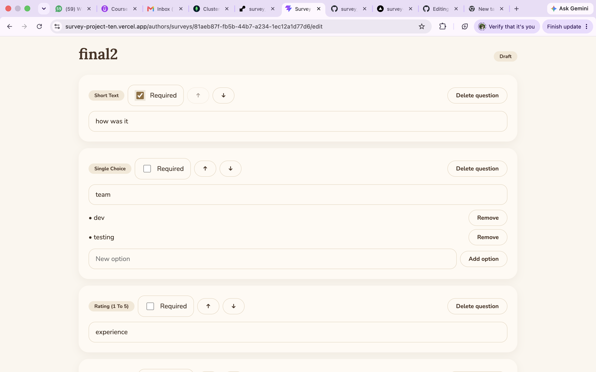
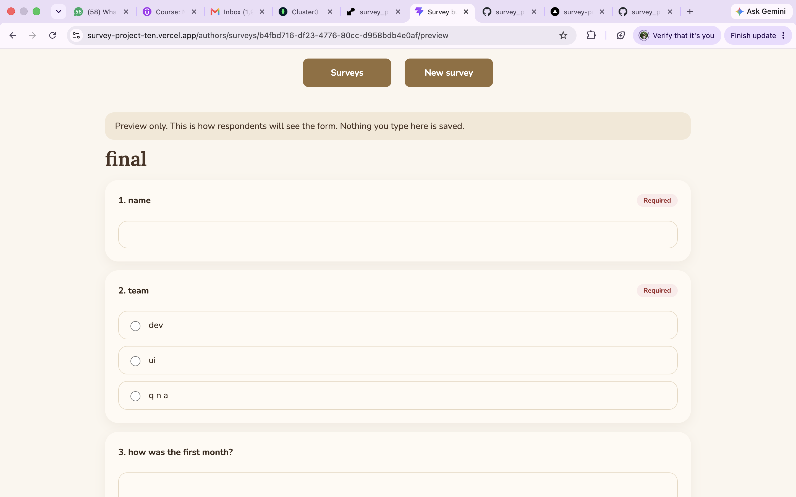
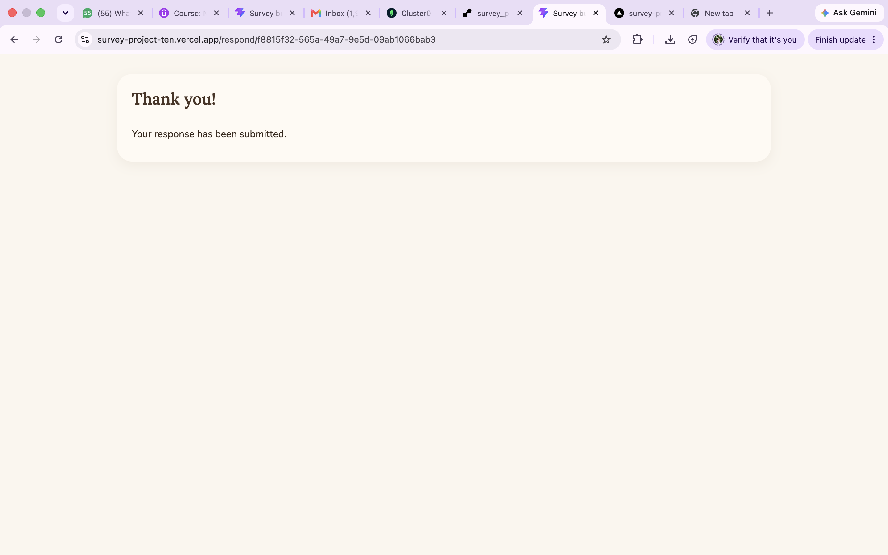
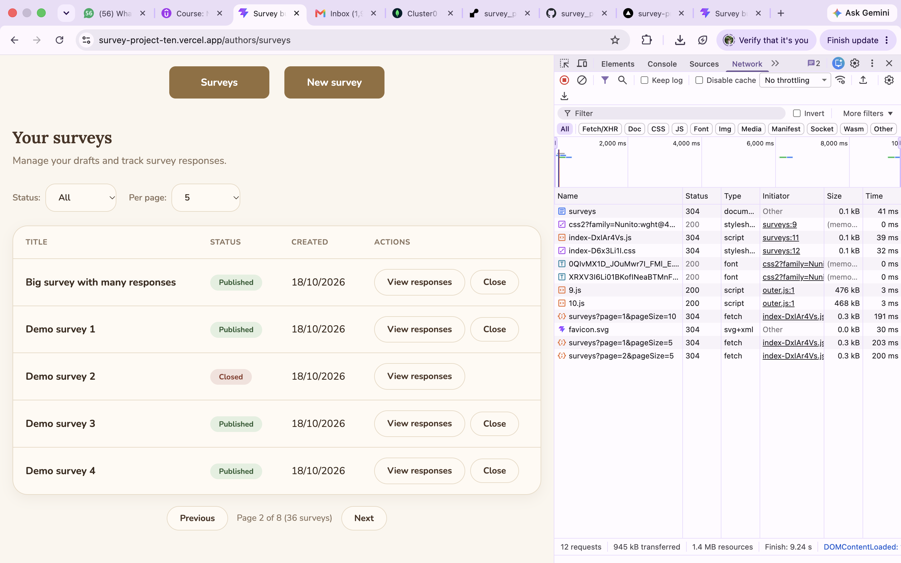

# Acceptance Checklist

Tested locally with Docker MongoDB, the backend on `localhost:4000` and the frontend on `localhost:5173`, after running `npm run reset` and `npm run seed`. 

## 1. Draft editing and preview

**Steps**
1. Create a draft survey with one question of each type: short text, long text, single choice, multiple choice and rating.
2. Edit the text of one question and delete another question.
3. Add a choice option and remove one.
4. Reload the page.
5. Try to add a sixth question.
6. Open Preview.

**Expected:** Changes are still there after reload. A sixth question is not allowed. Preview shows the current form and does not create a response.

**Actual:** The draft saved all five question types. The edit, the deleted question and the added and removed options were all still there after reloading. When the survey had five questions, the Add question button was disabled and the message "A survey can have only 5 questions" appeared. A direct API call for a sixth question returned 409. Preview showed the current form with the submit button disabled, and the response count stayed the same.

**Evidence**
> Editor page:

> Preview page: 

> More than 5 questions not allwoed:

---

## 2. Publication validation

**Steps**
1. Click Publish on an empty survey.
2. Click Publish on a survey where a choice question has only one option.
3. Add the missing option and publish again.

**Expected:** The empty survey and the invalid survey do not publish and show a clear message. The corrected survey publishes. 
**Actual:** Publishing the empty survey failed with "A survey needs at least one question". Publishing with a one-option choice question failed with "A choice question needs at least two options". After adding the second option, the survey published and its status changed to Published. 

**Evidence**
> Empty survey cannot be published:

> Choice questions need options:

---

## 3. Published questions stay fixed

**Steps**
1. Publish a survey.
2. In the editor, try to edit, add or remove a question or option.

**Expected:** Questions and options stay exactly the same, including after responses exist. 

**Actual:** After publishing, the edit option is not seen for that survey. Veiw Responses appears.

**Evidence**

**Evidence**
> Published surveys have no edit option:

> Only draft surveys are editable:

---

## 4. Valid answers persist

**Steps**
1. Run `docker compose up -d`.
2. Submit a response that answers all five question types.
3. Open the results and the response list.
5. Restart the API and the database
6. Open the results and the response list again.

**Expected:** Both responses save. The answers and the response count are the same after the restart.

**Actual:** Both submissions returned 201 and showed the confirmation screen. The results showed 2 responses and the response list showed both sets of answers. After restarting the database and the API without deleting volumes, the count and answers were unchanged.

**Evidence**

> Respondent form:

> Submission successful

---

## 5. Invalid answers are rejected by the API

**Steps:** Send each of these directly to `POST /surveys/:id/responses`, and check the response count before and after.

| Case | Expected | Actual |
|------|----------|--------|
| Blank answer to a required question | 400 | 400 |
| Unknown question id | 400 | 400 |

**Expected:** Every request fails, nothing is saved, and the response count does not change.

**Actual:** All requests were rejected with 400 and a message naming the problem. The response count was the same before and after.

**Evidence**
> Required question not answered:

> invalid question ID:

## 6. Closing stops new responses

**Steps**
1. Open a published survey's respondent form in one browser tab and fill it in without submitting.
2. In another tab, close the survey from the author screen.
3. Submit the first tab.
4. Try opening survey from response page

**Expected:** The submission is rejected. Existing responses and results are still available. The respondent screen says the survey is closed.

**Actual:** After the survey was closed, submitting the already-open form failed with "This survey is closed" (409), and the typed answers stayed in the form. The existing responses and results were still available on the author side. 

**Evidence**

>respondent screen showing the closed message after reload

## 7. Both lists paginate

**Steps**
1. Seed the data (`npm run seed`).
2. On the dashboard, go through several pages and watch the Network tab.
3. Change the status filter, then change the page size, and check that it goes back to page 1.
4. Go to the first page, the last page and a page beyond the end.
5. Repeat the page checks on the response list of "Big survey with many responses" (27 responses).
6. Call the API with `page=0`, `pageSize=51` and `page=abc`.
7. Stop the backend and reload the page.

**Expected:** Each request returns only one page, with the correct `total`. Pages have a fixed order with no overlaps. A page past the end gives an empty list with the right totals. Invalid values return 400. Loading and error states show.

**Actual:** With 31 seeded surveys, every page request (`?page=2&pageSize=10`) returned only that page's items with `total` 31, and the order stayed the same on repeat visits with no overlap. Changing the status filter or the page size went back to page 1. A page beyond the end returned an empty list with the correct totals. `page=0`, `pageSize=51` and `page=abc` returned 400. The response list for the big survey paged the same way (27 responses, 3 pages at 10 per page). The UI showed a loading message while fetching and an error message with a retry button when the backend was stopped.

**Evidence**

> **Screenshot 1:** dashboard page with the Network request showing
> 

---

### 8. Results Include All Responses

**Steps**

1. Open a published survey that has responses.
2. View the response summary and the list of responses.

**Expected:** The summary displays the total number of responses, option counts, the average rating, and text answers based on all responses. The response list displays each submitted response along with its answers.

**Actual:** The summary displayed the total number of responses, option counts, the average rating, and text answers correctly. The response list displayed each submitted response with its answers and was paginated correctly.

---

## Known limitations

- No login, so author pages are not protected (out of scope).
- Published survey questions cannot be edited (out of scope).
- Saving replaces the whole survey document, so two edits at the same moment could overwrite each other.
- The free API host sleeps when idle, so the first request on the live site can be slow.
